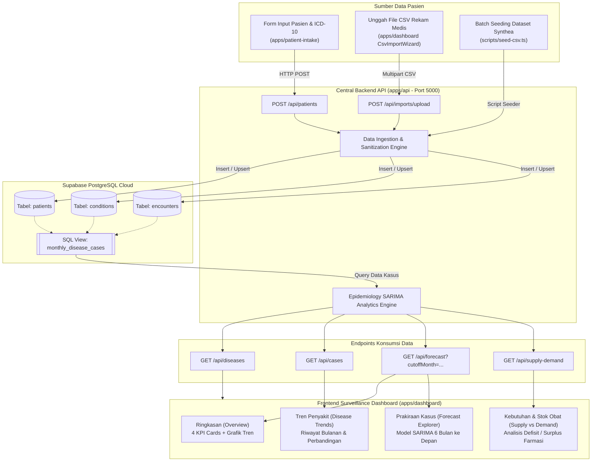

# EpiTrend — Disease Trend Forecasting & Surveillance Ecosystem

EpiTrend adalah sistem surveilans epidemiologi dan peramalan tren kasus penyakit musiman tingkat fasilitas kesehatan/rumah sakit. Sistem ini mengintegrasikan data rekam medis pasien (rekam kunjungan dan diagnosis ICD-10/SNOMED) untuk menghasilkan proyeksi beban kasus di masa mendatang serta membantu perencanaan alokasi logistik farmasi (kebutuhan vs ketersediaan obat).

---

## 🏛️ Arsitektur Ekosistem & Multi-Repo

Ekosistem EpiTrend dibangun di atas arsitektur monorepo modular yang membagi layanan ke dalam 3 aplikasi independen serta database PostgreSQL di cloud:

```
epitrend-ecosystem/
├── apps/
│   ├── dashboard/       # Frontend Surveilans & Analitik (Port 3000)
│   ├── api/             # Backend Sentral Express & Machine Learning (Port 5000)
│   └── patient-intake/  # Portal Entri Pasien & Diagnosis ICD-10 (Port 3001)
├── csv/                 # Dataset Rekam Medis (Synthea)
└── supabase-schema.sql  # DDL Skema Relasional & SQL View
```

- **`apps/dashboard`** (`epitrend-health/dashboard-web`): React + Vite + TailwindCSS + Recharts.
- **`apps/api`** (`epitrend-health/hospital-core-api`): Node.js + Express + TypeScript + Supabase Client + Python SARIMA.
- **`apps/patient-intake`** (`epitrend-health/patient-intake-web`): React + Vite + TailwindCSS + Lucide.
- **Database**: Supabase PostgreSQL Cloud (Tabel `patients`, `conditions`, `encounters`, `organizations`, dan View `monthly_disease_cases`).

---

## 🔄 Data Flowchart (Alur Data)

Alur pergerakan data dari input rekam medis hingga menghasilkan proyeksi analitik:



---

## 👤 User Flow (Alur Pengguna)

Alur kerja petugas medis dan pengambil kebijakan saat menggunakan EpiTrend:

```mermaid
flowchart TD
    Start([Pengguna Mengakses Sistem]) --> RoleCheck{Peran Pengguna?}

    %% Alur Petugas Pendaftaran / Staf Medis
    RoleCheck -->|Staf Medis / Intake| P1["Buka Portal Patient Intake (:3001)"]
    P1 --> P2["Isi Data Pasien:<br/>Nama, MRN, Umur, Gender, Tanggal"]
    P2 --> P3["Pilih Diagnosis Penyakit / Kode ICD-10"]
    P3 --> P4["Klik 'Daftarkan Pasien'"]
    P4 --> P5{"Apakah Input Valid?"}
    P5 -->|Tidak| P2
    P5 -->|Ya| P6["Kirim ke API /api/patients"]
    P6 --> P7["Data Tersimpan di Database Supabase"]
    P7 --> P8["Live Feed Pasien Terupdate Otomatis"]

    %% Alur Staf Surveilans & Manajemen RS
    RoleCheck -->|Epidemiolog / Manajemen| D1["Buka Surveillance Dashboard (:3000)"]
    D1 --> D2["Tentukan Filter Rentang Waktu"]
    D2 --> ModeChoice{Pilih Mode Filter}
    ModeChoice -->|Pilih Tahun Langsung| D3A["Klik Tombol Tahun:<br/>2021, 2020, 2019, 2018, Semua"]
    ModeChoice -->|Fleksibel (Kustom)| D3B["Pilih Dari Tanggal & Sampai Tanggal<br/>lalu Klik 'Terapkan Rentang'"]

    D3A --> D4["Sistem Memuat Data Historis & Model SARIMA"]
    D3B --> D4

    D4 --> D5{"Pilih Menu Analisis"}
    D5 -->|Ringkasan| M1["Lihat Metrik Utama & Grafik Proyeksi 6 Bulan"]
    D5 -->|Tren Penyakit| M2["Analisis Kasus Historis per Penyakit"]
    D5 -->|Prakiraan Kasus| M3["Eksplorasi Proyeksi Multi-Penyakit & Confidence Interval"]
    D5 -->|Kebutuhan & Stok| M4["Cek Kebutuhan Obat vs Alokasi Stok RS (Defisit / Surplus)"]
    D5 -->|Unggah CSV| M5["Upload File Rekam Medis Bulanan Baru"]

    M5 --> U1["Tarik File .csv ke Area Unggah"]
    U1 --> U2["Sistem Memvalidasi Format Kolom"]
    U2 --> U3["Simpan ke Database Supabase"]
    U3 --> D4
```

---

## 🚀 Panduan Menjalankan Sistem Secara Lokal

### Prasyarat
- Node.js (v18+)
- npm atau bun
- Akun Supabase (PostgreSQL Cloud)

### 1. Kloning Repositori
```bash
git clone https://github.com/epitrend-health/dashboard-web.git
cd epitrend-—-disease-trend-forecasting-dashboard
```

### 2. Instalasi Dependensi
```bash
# Install root & workspace dependencies
npm install
cd apps/dashboard && npm install
cd ../api && npm install
cd ../patient-intake && npm install
cd ../..
```

### 3. Konfigurasi Environment Variable
Salin `.env.example` ke file `.env` di masing-masing sub-proyek:
- **`apps/api/.env`**:
  ```env
  PORT=5000
  SUPABASE_URL="https://<project-ref>.supabase.co"
  SUPABASE_SERVICE_ROLE_KEY="<service-role-secret>"
  CORS_ORIGINS="http://localhost:3000,http://localhost:3001"
  ```
- **`apps/dashboard/.env`**:
  ```env
  VITE_API_BASE_URL="http://localhost:5000/api"
  VITE_USE_MOCK_DATA="false"
  ```
- **`apps/patient-intake/.env`**:
  ```env
  VITE_API_BASE_URL="http://localhost:5000/api"
  ```

### 4. Setup Database & Seeding
1. Eksekusi query DDL yang ada di `apps/api/supabase-schema.sql` pada **SQL Editor Dashboard Supabase**.
2. Jalankan batch seeder untuk mengisi data awal:
   ```bash
   npm run seed:data
   ```

### 5. Menjalankan Semua Layanan
Jalankan dev server secara paralel:
```bash
npm run dev
```
Aplikasi akan tersedia di:
- **Dashboard Surveilans:** `http://localhost:3000`
- **Portal Entri Pasien:** `http://localhost:3001`
- **Core API Backend:** `http://localhost:5000`

---

## 📋 Lisensi
Proyek ini didistribusikan di bawah lisensi **Apache-2.0**.
